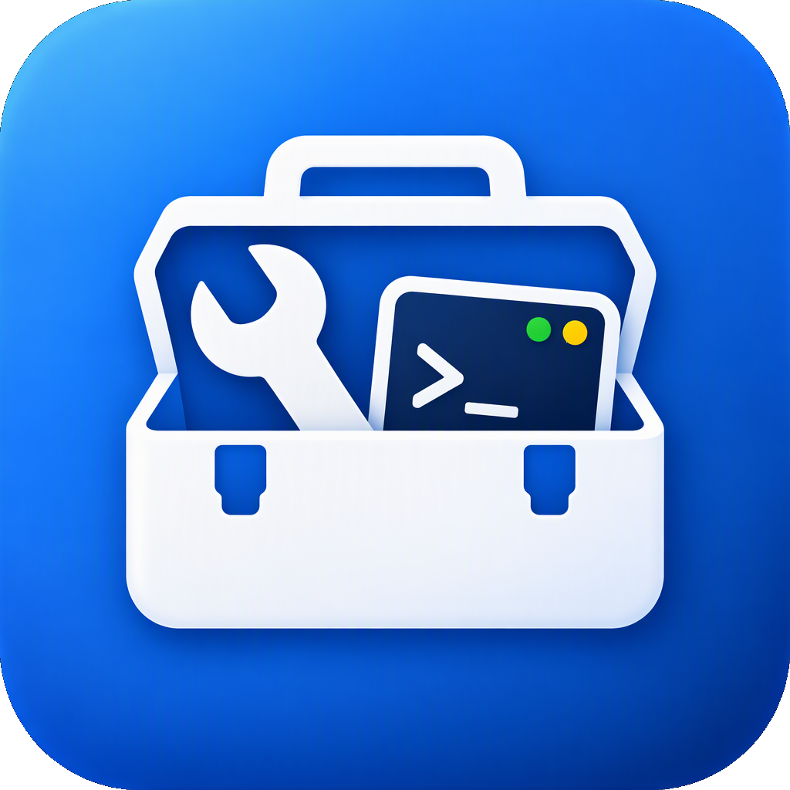

# 系统工具箱（Toolbox）



[](https://github.com/FantasyEngineer/personal_tool/actions/workflows/build.yml)
[](LICENSE)

一个用 PyQt5 写的跨平台桌面工具箱，把日常开发和系统运维里零散的小工具收进同一个窗口。单文件代码（`toolbox.py`），Windows / macOS 都能跑。

## 功能

### 系统工具

- **进程管理**：查看进程列表与端口占用，按名称过滤，结束进程
- **端口扫描**、**Ping 测试**、**DNS 查询**、**路由追踪**、**网络测速**
- **配置**：环境变量、进程内变量、Git 配置、软件镜像源、SSH 密钥、SSH 主机、显示开关（隐藏文件/扩展名）

### 文本处理

- **JSON / XML**：格式化、语法校验、搜索、复制
- **编解码**：Base64、URL、Unicode 转义
- **哈希计算**：MD5 / SHA1 / SHA256 / SHA512，支持文本和文件（可拖拽）
- **加解密**：
  - JWT：解析、校验签名（HS/RS/PS/ES 系列）、检查过期时间
  - AES：AES-256-GCM / AES-128-GCM / AES-256-CBC / AES-256-CTR，支持口令派生密钥
  - RSA：生成密钥对、OAEP 加密 / 解密、签名 / 验签
  - HMAC、口令哈希（PBKDF2-SHA256 / scrypt）、随机密钥生成
- **正则测试**、**文本对比**、**UUID/二维码**
- **格式转换**：颜色格式、时间戳、JSON ↔ YAML
- **文本统计**、**Cron 表达式**

### 数学工具

进制转换、商余计算、单位转换、随机数、金额大写、罗马数字

### 其他

- **命令速查**：297 条常用命令，覆盖 Linux（117）、Windows（44）、Docker（40）、Git（40）、Vim（39）、SSH（17），支持搜索与分类筛选
- **房贷计算器**
- **图片处理**：质量压缩、按比例调整尺寸（含一寸/二寸等证件照预设）、格式转换
- **文字雨**：Matrix 风格全屏动画
- **防黑屏**：阻止系统息屏 / 锁屏

底部状态栏实时显示 CPU、内存占用、本机 IP/MAC（点击 IP 复制），以及入口：仓库链接。

## 下载

到 [Releases](https://github.com/FantasyEngineer/personal_tool/releases) 页面下载：

| 平台 | 文件 | 说明 |
| --- | --- | --- |
| Windows 10/11 x64 | `Toolbox-windows.exe` | 单文件，双击即用，无需安装 |
| macOS | `Toolbox-macos.zip` | 解压得到 `Toolbox.app`，拖进「应用程序」 |

首次运行提示的处理：

- **Windows**：未签名的 exe 可能被 SmartScreen 拦截，点「更多信息 → 仍要运行」。
- **macOS**：应用目前是 ad-hoc 签名，首次打开需在图标上右键 →「打开」。

## 从源码运行

需要 Python 3.9+（CI 使用 3.11）。

```bash
git clone https://github.com/FantasyEngineer/personal_tool.git
cd personal_tool

python -m venv .venv
# Windows
.venv\Scripts\activate
# macOS / Linux
source .venv/bin/activate

pip install -r requirements.txt
python toolbox.py
```

## 自行打包

```bash
pip install pyinstaller
pyinstaller --noconfirm toolbox.spec
```

产物：

- Windows：`dist/Toolbox.exe`（单文件）
- macOS：`dist/Toolbox/Toolbox.app`

也可以直接运行 `./build_local.sh`，它会创建虚拟环境、安装依赖并打包当前平台。

## 持续集成

[`.github/workflows/build.yml`](.github/workflows/build.yml) 在 macOS 和 Windows 原生 runner 上分别构建：

- 推送到 `main`：构建并上传构建产物（artifact）
- 推送 `v*` 标签：额外发布 GitHub Release
- Windows 发布物通过 [SignPath](https://signpath.org/) 签名（需在仓库 Secrets 中配置 `SIGNPATH_API_TOKEN`，Variables 中配置组织/项目/策略；未配置时自动跳过）

## 项目结构

```
toolbox.py            # 全部界面与逻辑
toolbox.spec          # PyInstaller 打包配置
assets/               # 图标与图标生成脚本
requirements.txt      # 运行依赖
build_local.sh        # 本地一键打包
.github/workflows/    # CI（构建、发布、签名）
```

## 技术栈

PyQt5 · qrcode · Pillow · PyYAML · cryptography · PyInstaller

## 许可证

[MIT](LICENSE)
